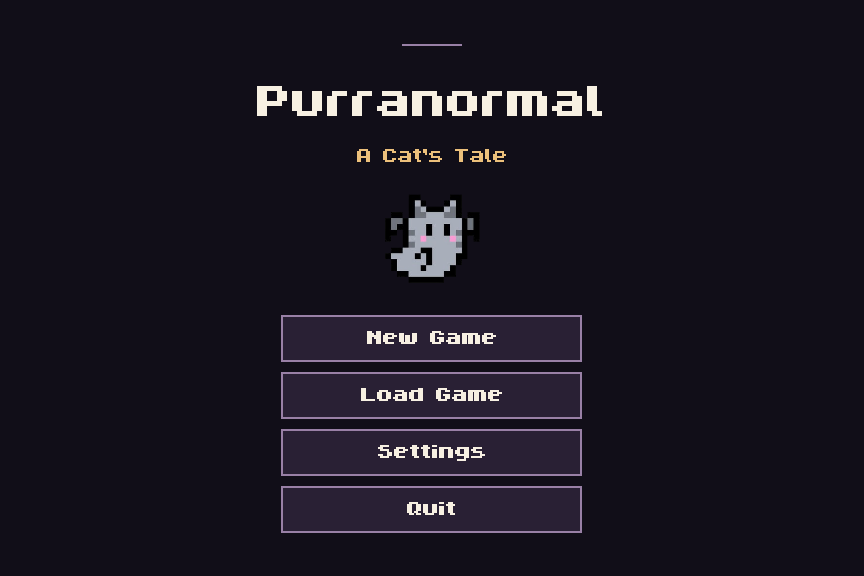
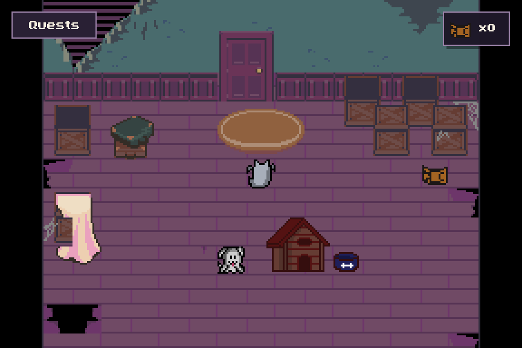
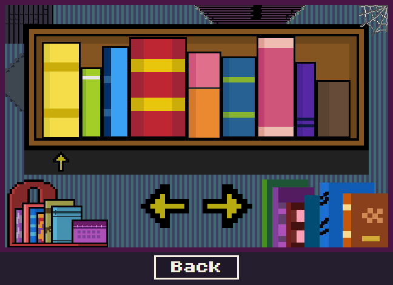
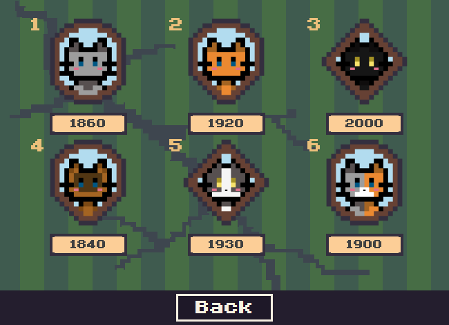

# Purranormal A Cat's Tale

A pixel-art exploration and puzzle game by **kousagii**, built with Java Swing.

Play as Coby, a ghost cat wandering through a quiet house filled with memories.
Explore its rooms, collect photographs, and solve book and portrait sorting
puzzles to uncover the story.

## Screenshots

Title screen and exploration:

  
  

Book and portrait sorting puzzles:

  
  

## Requirements

- Windows with PowerShell 5.1 or newer for the included launcher.
- **JDK 17 or newer**, including java, javac, and jar.
- A desktop session to display the game.

No external Java libraries, Maven, or Gradle installation is required.
[Download a JDK from Eclipse Adoptium](https://adoptium.net/temurin/releases/).
JDK 21 also works and is a good choice when using current VS Code Java extensions.

## Install and run

1. Clone this repository, or use **Code > Download ZIP** on GitHub and extract it.
2. Open the extracted project folder in VS Code.
3. Open **Terminal > New Terminal** in the project root.
4. Run:

~~~powershell
powershell -NoProfile -ExecutionPolicy Bypass -File .\scripts\dev.ps1 run
~~~

The launcher finds an installed JDK, compiles the source, and starts the game.
If it cannot find your JDK, set JAVA_HOME to its installation folder, restart
the terminal, and try again. JAVA_HOME should point to the folder containing
bin, rather than to bin itself.

For Java editing support, install **Extension Pack for Java** from VS Code's
Extensions view. You can run the terminal command above without that extension.

### Build a runnable JAR

~~~powershell
powershell -NoProfile -ExecutionPolicy Bypass -File .\scripts\dev.ps1 package
~~~

This creates dist/Purranormal.jar. With Java on PATH, launch it from a writable
folder using:

~~~powershell
java -jar .\dist\Purranormal.jar
~~~

Close running copies of the JAR before rebuilding it on Windows.

## How to play

| Control | Action |
|---|---|
| W A S D | Move |
| Space | Interact with the object you face or advance dialogue |
| Escape | Pause or resume |
| Mouse | Menus, quests, and photo pickup or placement |
| Book puzzle arrows | Select a book |
| A / D in a book puzzle | Move the selected book left or right |
| Drag and drop in the portrait puzzle | Swap portraits |

The **Space: interact** prompt appears when an object is in reach.
Walk into doors to enter rooms. Sort the left shelf by height, the right shelf
by width, and the portraits by date.

Use **Pause > Save** to save your progress. **Load Game** continues from
savegame.dat in the project folder. **New Game** and **Play Again** keep your
previous save until you choose Save again.

Music volume is available in **Settings > Music Volume** and starts at 45%.

## Credits

- **Game creator and developer:** kousagii.
- **Tilemap:** Chippotato — [Spooky Mansion Pack](https://chippotato.itch.io/spooky-mansion-pack).
- **Music:** Yoiyami — [First Light Particles](https://opengameart.org/content/first-light-particles-%E2%80%93-cc0-atmospheric-pianoambient-track).
- **Interface and wooden sound effects:** Kenney — [Interface Sounds](https://kenney.nl/assets/interface-sounds) and [Impact Sounds](https://kenney.nl/assets/impact-sounds).
- **Paper and book sound effects:** Luckius — [Various Paper Sound Effects](https://opengameart.org/content/various-paper-sound-effects).
- **Font:** ByteBounce.

The listed music and sound effects are **CC0 1.0 Universal**. Their source and
license notices are included in [res/sound/licenses](res/sound/licenses).
Those audio licenses do not change the licenses of the other assets.

